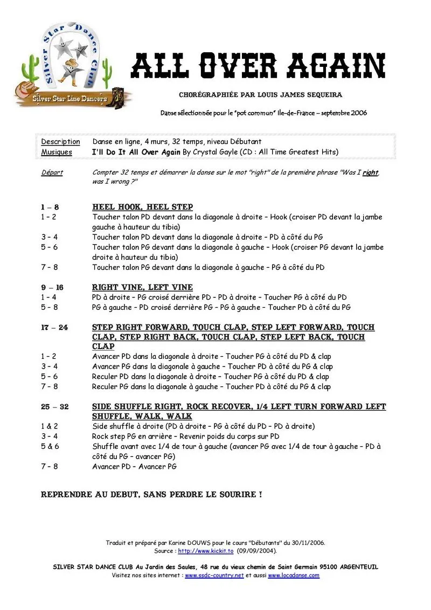

# All Over Again
**All Over Again** est une danse country en ligne de 32 temps, 4 murs, sans tag ni restart.

## Caractéristiques
- **Type :** Line Dance
- **Nombre de comptes :** 32
- **Nombre de murs :** 4
- **Tags & Restart :** aucun
- **Niveau :** 
- **Chorégraphe :** Louis James Sequeira
- **Musique :** "That Don’t Impress Me Much" par Shania Twain
- **Date d'apprentissage :** 8 novembre 2018

## 💃 Vidéo

<iframe width="560" height="315" src="https://www.youtube-nocookie.com/embed/ideL3ILIaT8?si=ln2HgJrd3J3_DJtN" title="YouTube video player" frameborder="0" allow="accelerometer; autoplay; clipboard-write; encrypted-media; gyroscope; picture-in-picture; web-share" referrerpolicy="strict-origin-when-cross-origin" allowfullscreen></iframe>

*All Over Again Line Dance / frederab**

## 🌵 Feuille de danse 

  **📥 [Ouvrir ou télécharger la feuille de pas (PDF)](../Medias/A-C/all-over-again.pdf)**

## 🎶 À propos de la chanson

<iframe width="560" height="315" src="https://www.youtube-nocookie.com/embed/mqFLXayD6e8?si=EaDKm5EXk3_h62ZD" title="YouTube video player" frameborder="0" allow="accelerometer; autoplay; clipboard-write; encrypted-media; gyroscope; picture-in-picture; web-share" referrerpolicy="strict-origin-when-cross-origin" allowfullscreen></iframe>

*Shania Twain – That Don’t Impress Me Much (Official Music Video)*  

## Références
- Source pdf https://www.countrydancer.fr

🔙 [Retour à la page Chorés A-B-C](./index.md)
