# Artistes Country
Voici une liste d’artistes country incontournables, classés par époque et style : 
## 🎶 Les Pionniers (années 1920-50)
**Jimmie Rodgers** – Considéré comme le « père de la country », connu pour ses blue yodels.

**The Carter Family** – Une des premières familles de la country, avec des chansons comme Can the Circle Be Unbroken.

**Hank Williams** – Véritable légende du honky tonk, avec des classiques comme Your Cheatin’ Heart et I’m So Lonesome I Could Cry.

  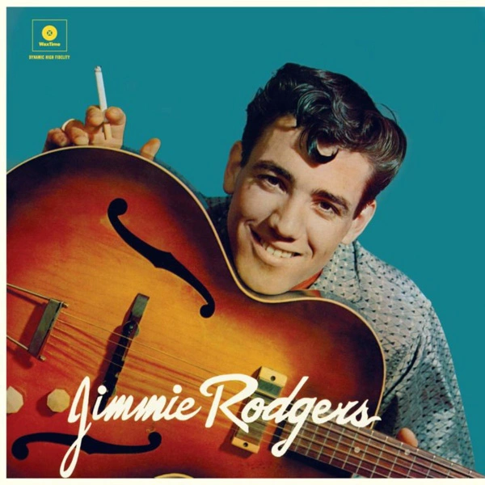
  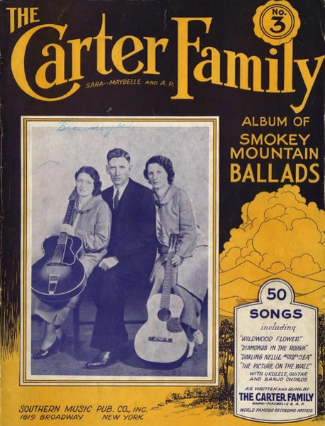
  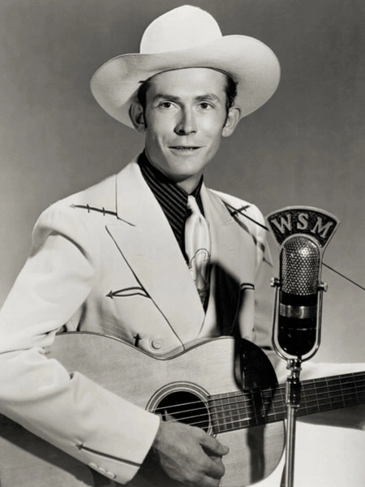

## 🎸 L’Âge d’Or de la Country (années 1950-70)
**Johnny Cash** – « The Man in Black », connu pour Ring of Fire, Folsom Prison Blues et I Walk the Line.

**Patsy Cline** – Icône de la country, avec des ballades comme Crazy et Walkin’ After Midnight.

**Merle Haggard** – Pilier du « Bakersfield Sound », avec Mama Tried et Okie from Muskogee.

**Loretta Lynn** – Légende féminine avec des chansons comme Coal Miner’s Daughter.

  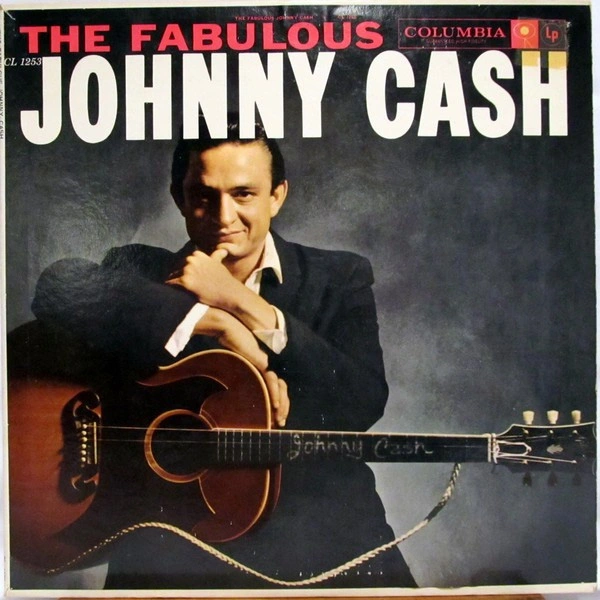
  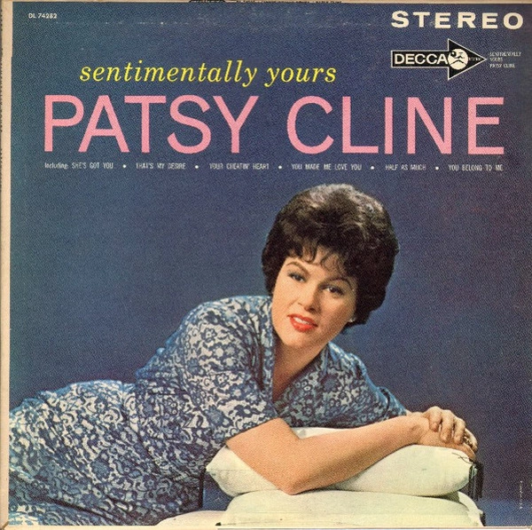
  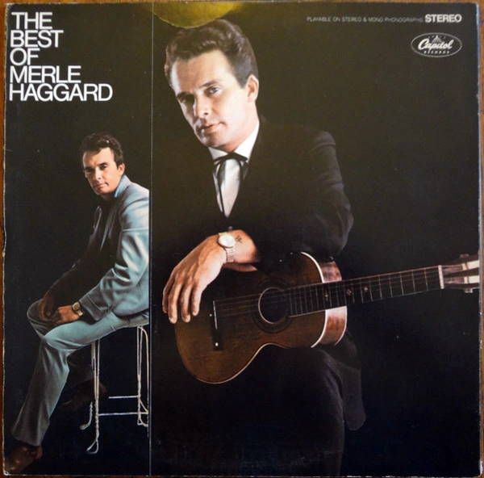
    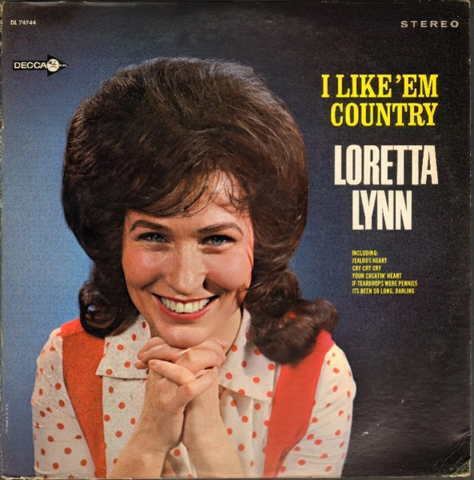

## 🤠 L’ère Outlaw (années 1970-80)
**Willie Nelson** – Un des leaders du mouvement « Outlaw », connu pour On the Road Again.

**Waylon Jennings** – Son style plus rebelle se retrouve dans Luckenbach, Texas.

**Kris Kristofferson** – Auteur-compositeur majeur, connu pour Me and Bobby McGee.

**Dolly Parton** – Icône country-pop avec Jolene et 9 to 5.

  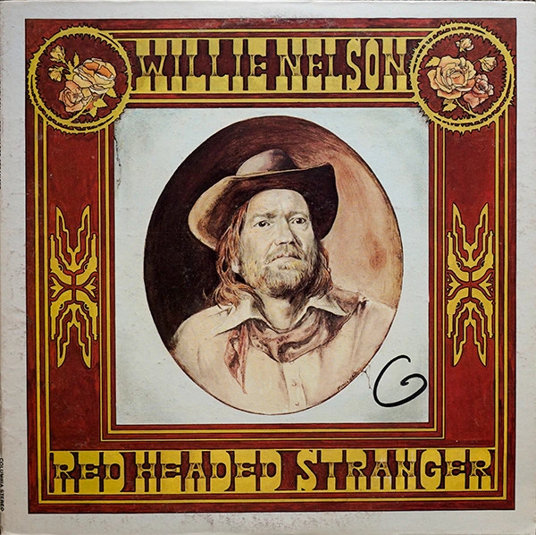
  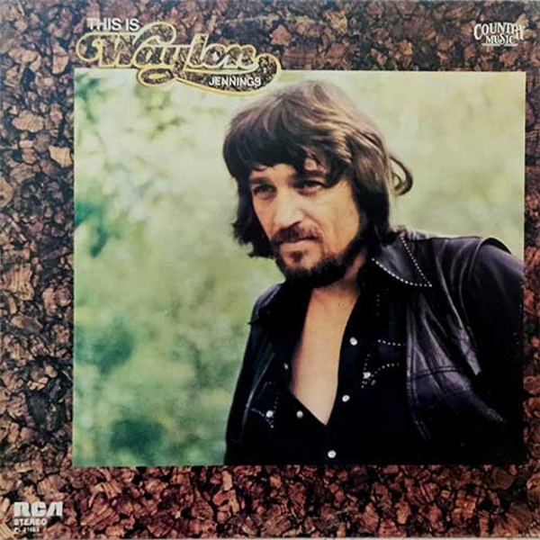
  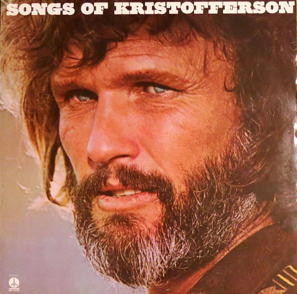
  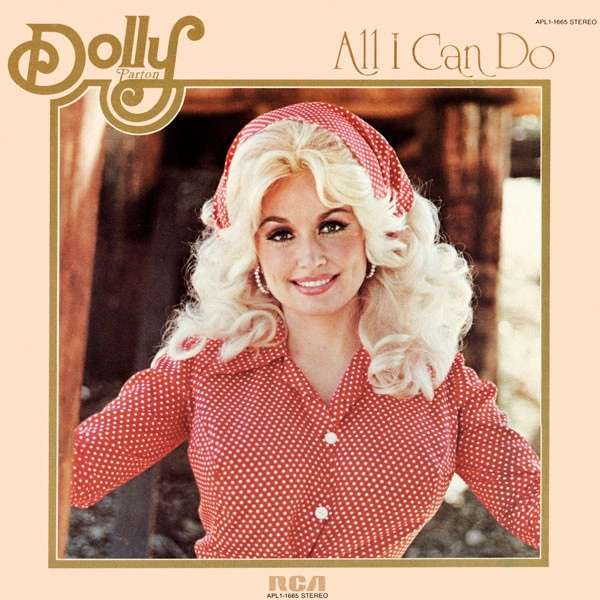

## 🌟 Country Pop & Mainstream (années 1990-2000)
**Garth Brooks** – L’un des artistes country les plus vendus avec Friends in Low Places.

**Shania Twain** – Reine de la country pop, avec Man! I Feel Like a Woman!

**Tim McGraw** – Connu pour Live Like You Were Dying.

**Faith Hill** – Hits comme Breathe et This Kiss.

**Alan Jackson** – Mélange de country traditionnelle et moderne (Chattahoochee).

  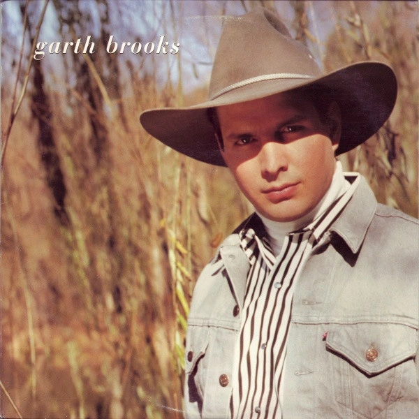
  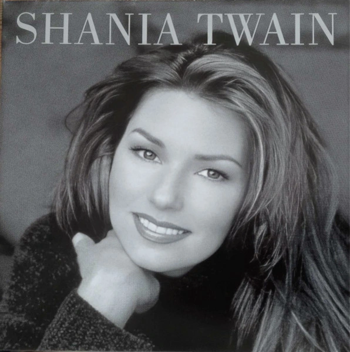
  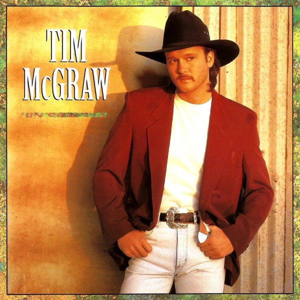
  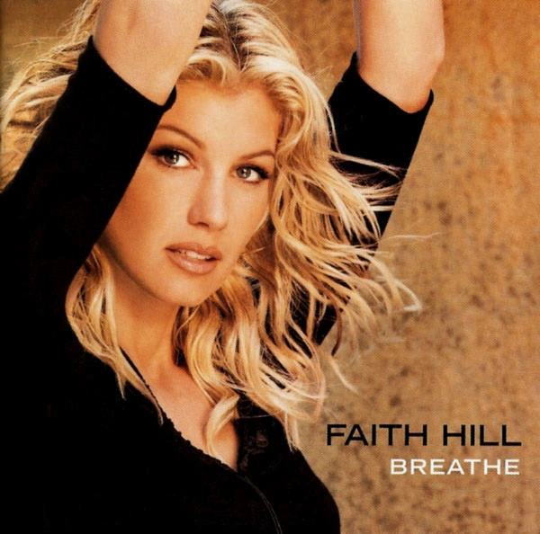
  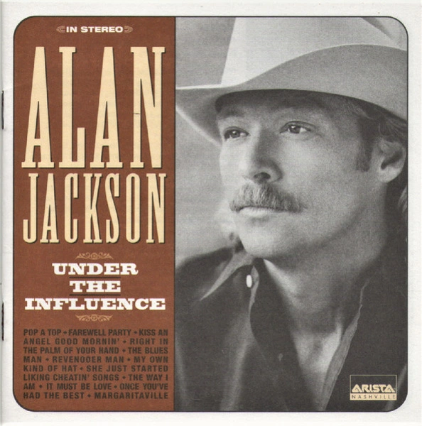

## 🎤 Country Moderne et Fusion (années 2010-aujourd’hui)

**Chris Stapleton** – Son bluesy et authentique, avec Tennessee Whiskey.

**Kacey Musgraves** – Mélange country et pop alternative, connue pour Follow Your Arrow.

**Luke Combs** – Voix puissante et succès comme Beautiful Crazy.

**Morgan Wallen** – Star du « bro-country », avec Last Night.

**Carrie Underwood** – Révélée par American Idol, avec Before He Cheats.

**Zach Bryan** – Nouvelle génération de country-folk, avec Something in the Orange.

  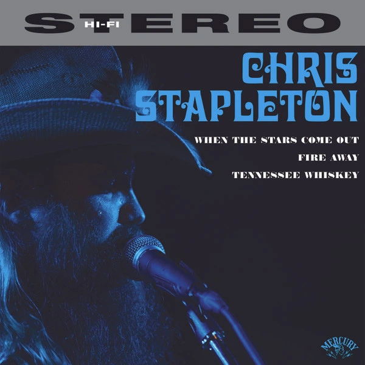
  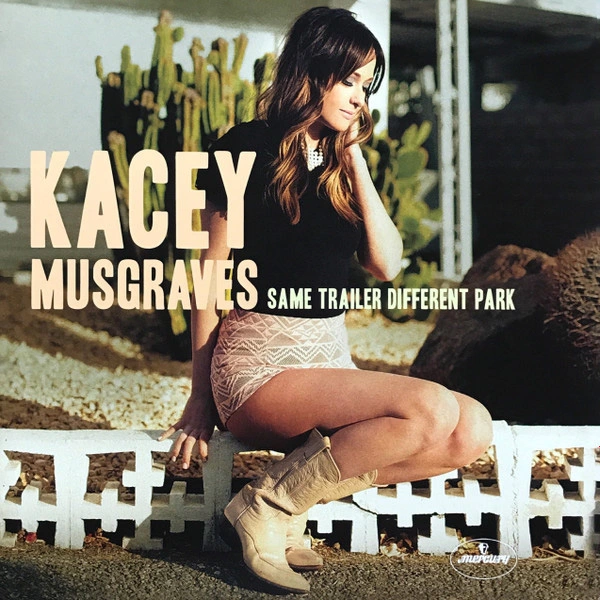
  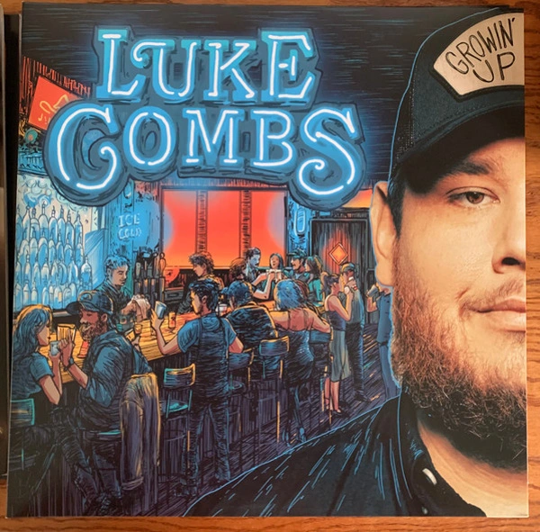
  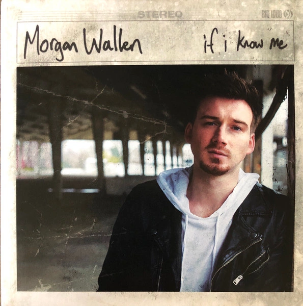
  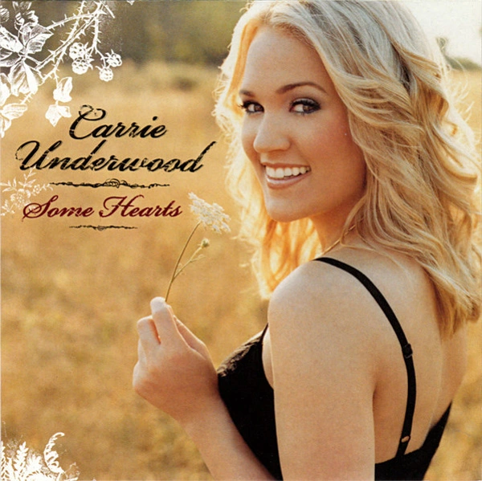
  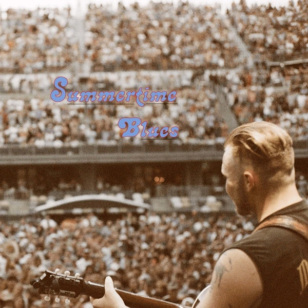

**Références** :

- Source des images : www.discogs.com 

🔙 [Retour à la page Ressources](./index.md)